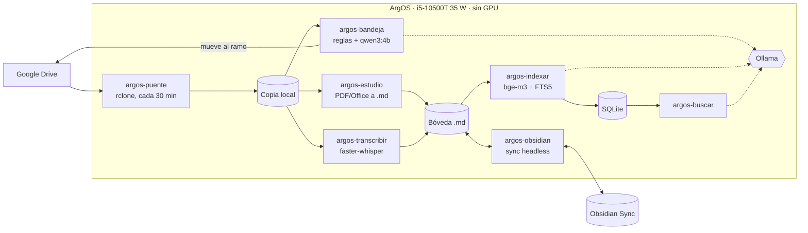

<h1 align="center">ArgOS</h1>

<p align="center"><b>Un mini PC de 35 W y sin GPU que ordena, convierte, transcribe e indexa toda mi vida académica con IA local.</b></p>

<p align="center">
  
  
  
  
  
  
</p>

ArgOS es mi home lab: un mini PC de oficina con Linux que trabaja solo, 24/7. Recoge lo que subo a Google Drive, lo clasifica, lo convierte en notas Markdown dentro de mi bóveda de Obsidian, transcribe las grabaciones de clase, indexa todo para búsqueda semántica y se respalda cada noche. **Toda la IA corre en la propia máquina, solo con CPU:** sin suscripciones y sin mandar mis apuntes a servicios de terceros.

> Proyecto personal de Diego Pazos, estudiante de Ingeniería en Informática. Es mi proyecto principal y el que más me ha enseñado sobre Linux, systemd, automatización e IA local.

## Lo destacado

- **7 servicios systemd activos** (6 timers + Sync continuo) coordinados con horarios escalonados y locks para que las tareas pesadas no compitan por la CPU.
- **220 notas y 1.982 fragmentos** en un índice de búsqueda híbrida (embeddings `bge-m3` + FTS5). Una pasada incremental tarda unos 25 s.
- **`qwen3:4b` a ~12 tokens/s** en CPU, validado con una prueba sostenida de 15 minutos: sin reinicios y con 72 °C de máximo.
- **Transcripción de clases con Whisper `large-v3-turbo` (int8)**, que se pausa sola si la CPU llega a 82 °C.
- **Clasificación con IA desconfiada:** las reglas deciden primero y el modelo solo mueve un archivo si coincide consigo mismo en dos preguntas, dice tener seguridad y lo respalda una palabra clave.
- **Diseñado para no perder nada:** ningún servicio borra archivos, todo se rastrea por sha256 y hay respaldo restic diario con verificación semanal.

## Hardware

| Componente | Detalle |
|---|---|
| CPU | **Intel Core i5-10500T**: 6 núcleos / 12 hilos, **TDP 35 W** |
| GPU | **Ninguna**: embeddings, LLM y Whisper corren en CPU |
| RAM | 16 GB (≈14 GiB utilizables) + 4 GiB de swap |
| Disco | NVMe de 512 GB |
| SO | Ubuntu 26.04 LTS (kernel 7.0) |

## Por qué existe

Tengo material de siete ramos repartido en PDFs, presentaciones, grabaciones y apuntes. Quería:

- **Un solo lugar ordenado**, mi bóveda de Obsidian, sin mover archivos a mano.
- **Buscar por significado** en todo lo que he estudiado y pasarle ese contexto a un asistente.
- **IA sin suscripciones** para el trabajo rutinario.
- **Demostrar que se puede con hardware modesto**: un mini PC usado de 35 W.

## Arquitectura



Además: `argos-backup` (restic, diario) respalda todo el equipo, `argos-estado` resume el estado de cada servicio y **Uptime Kuma** vigila todo cada minuto con alertas por ntfy ([monitoreo](docs/10-uptime-kuma.md)).

## Servicios y timers

| Unidad systemd | Cuándo | Qué hace | Doc |
|---|---|---|---|
| `argos-puente` | cada 30 min | Copia la carpeta de trabajo de Drive a disco local con rclone (solo agrega/actualiza, nunca borra) | [bandeja](docs/01-bandeja.md) |
| `argos-bandeja` | :10 y :40 | Clasifica lo que cae en `00 Bandeja` y lo mueve a la carpeta del ramo en Drive. Reglas primero, IA solo si hay duda | [bandeja](docs/01-bandeja.md) |
| `argos-estudio` | :25 cada hora | Convierte material nuevo (PDF, DOCX, PPTX, XLSX) en notas `.md` en la bóveda, sin IA | [estudio](docs/02-estudio.md) |
| `argos-busqueda` | :35 cada hora | Regenera el mapa de la bóveda y el índice semántico incremental | [búsqueda](docs/04-busqueda.md) |
| `argos-transcribir` | 00:30 diario | Transcribe grabaciones de clase a notas con marcas de tiempo | [transcripción](docs/06-transcripcion.md) |
| `argos-backup` | 03:30 diario | Respaldo restic con retención y verificación semanal | [backups](docs/08-backups.md) |
| `argos-obsidian` | continuo | Obsidian Sync headless de la bóveda | [sync](docs/05-sync.md) |
| `argos-kuma-sondas` | cada minuto | Sondas locales (Ollama, Sync, Tailscale, recursos) para Uptime Kuma | [monitoreo](docs/10-uptime-kuma.md) |
| `argos-powercap` | al arranque | Límites de potencia de CPU (hoy desactivado) | [estado](docs/07-estado.md) |

Herramientas de línea de comandos: `argos-ia`, `argos-buscar`, `argos-md`, `argos-estado` ([IA local](docs/03-ia-local.md), [estado](docs/07-estado.md)).

Los horarios están escalonados a propósito (puente → estudio → índice; transcripción de noche y corte a las 03:00 antes del respaldo) para que dos tareas pesadas no compitan por la CPU.

## Stack

- **SO y orquestación:** Ubuntu, systemd (services + timers), `flock` para exclusión mutua, Bash y Python 3.14
- **IA local:** Ollama 0.40 con `qwen3:4b` (texto) y `bge-m3` (embeddings); faster-whisper `large-v3-turbo` int8 (voz)
- **Documentos:** pdftotext/poppler, markitdown, Tesseract (OCR spa+eng), ffmpeg
- **Datos:** SQLite + FTS5 + NumPy para el índice híbrido
- **Sincronización:** rclone (Google Drive), Obsidian Sync (CLI `ob`)
- **Respaldo:** restic

## Decisiones técnicas

| Decisión | Por qué |
|---|---|
| Reglas antes que IA | Es rápido y explicable, y no gasta CPU en lo obvio. El LLM solo entra en los casos dudosos. |
| Nunca borrar | El puente solo copia, la bandeja no sobrescribe y estudio crea una `(v2)` si edité una nota a mano. |
| Idempotente por sha256 | Volver a correr un servicio no duplica nada ni repite trabajo. |
| SQLite + NumPy, sin base vectorial | Con ~2.000 fragmentos, la fuerza bruta tarda milisegundos y no hay otro servicio que mantener. |
| Un archivo de estado por servicio | `argos-estado` muestra en un vistazo qué falló y hace cuánto. |
| Respetar las temperaturas | Pausas térmicas, `Nice`, `IOSchedulingClass=idle` y las tareas pesadas de noche. |

## Limitaciones conocidas

- **Obsidian Sync tiene un límite de 5 MB por archivo** en el plan actual, así que los PDFs más pesados no llegan a ArgOS por esa vía: se copian aparte y se verifican por SHA-256 (ver [sync](docs/05-sync.md)).
- **Los modelos de 8B están bloqueados**: son demasiado lentos en esta CPU y el equipo tiene problemas térmicos.
- **La transcripción corre solo de noche**, porque en clases largas va más lenta que el tiempo real.

## Roadmap

- [x] Puente Drive → ArgOS y clasificación automática de la bandeja
- [x] Conversión de material a Markdown con OCR
- [x] IA local (`qwen3:4b`) y búsqueda semántica híbrida (`bge-m3`)
- [x] Obsidian Sync headless
- [x] Transcripción nocturna de clases
- [x] Monitoreo de estado y respaldo diario con restic
- [x] Copia de los respaldos fuera del equipo (regla 3-2-1): el repositorio restic está en Google Drive (ver docs/08-backups.md)
- [x] Llevar los archivos de más de 5 MB por fuera de Sync, verificados por hash
- [x] Instalador reproducible para la nueva versión de la transcripción (términos por ramo y pruebas)
- [x] Script que compare la bóveda entre dispositivos
- [ ] Cambiar la pasta térmica para probar modelos más grandes
- [x] Notificaciones automáticas por ntfy cuando `argos-estado` detecte alertas (ver docs/09-alertas.md)
- [x] Monitoreo con Uptime Kuma: panel, página de estado, tareas push y aviso externo si ArgOS se apaga (ver docs/10-uptime-kuma.md)

## Estructura del repo

```text
argos-homelab/
├── README.md
├── docs/              Un documento por subsistema (índice en docs/README.md)
├── scripts/
│   ├── bin/           Scripts tal como corren en el servidor (sanitizados)
│   ├── systemd/       Unidades .service y .timer
│   └── config/        Ejemplos de configuración, sin secretos
└── LICENSE
```

Los scripts están **sanitizados**: la ruta de la bóveda, las carpetas de Drive, el usuario, los ramos y las credenciales se cambiaron por marcadores `<ASÍ>`. No es un instalador; es la referencia de cómo está montado el sistema.

## Licencia

[MIT](LICENSE) © 2026 Diego Pazos
