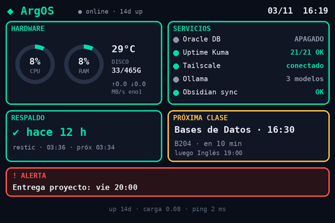

# Pantalla de estado (Turing Smart Screen 3.5")

**Hardware:** Turing Smart Screen 3.5" **Rev A** (USB `1a86:5722`, número de serie `USB35INCHIPSV2`, aparece como `/dev/ttyACM0`) · **Servicio:** `argos-screen.service` · **Código:** [`pantalla/`](../pantalla/)

Un tablero de 480×320 en horizontal que muestra de un vistazo el hardware, los servicios, el último respaldo, la próxima clase y las alertas. Usa la librería libre [mathoudebine/turing-smart-screen-python](https://github.com/mathoudebine/turing-smart-screen-python) solo para hablar con la pantalla; el dibujo se hace con Pillow.



## Hardware

Linux no la ve como monitor sino como un **puerto serie** USB (CDC-ACM). El programa le manda imágenes por ese puerto. No tiene táctil. Sin la app muestra "Please run the app".

### Rev A o Rev B

Las dos revisiones usan el mismo ID USB (`1a86:5722`), así que se distinguen por el **número de serie** (iSerial):

| iSerial | Revisión |
|---|---|
| `USB35INCHIPS…` (p. ej. `USB35INCHIPSV2`) | Rev A (Turing original) |
| `2017-2-25` | Rev B (XuanFang, con luces RGB traseras) |

```bash
lsusb -v -d 1a86:5722 2>/dev/null | grep iSerial
# o
udevadm info -q property -n /dev/ttyACM0 | grep ID_SERIAL
```

### Lección: el cable

Un cable USB-C que **solo carga** enciende la pantalla (muestra "Please run the app") pero no pasa datos: no aparece nada en `lsusb` ni en `dmesg`. Si la pantalla prende y el equipo no la ve, lo primero es probar otro cable que sí transmita datos.

## Instalación

```bash
# 1. Permiso para el puerto serie
sudo usermod -aG dialout <USUARIO>

# 2. Librería y venv
sudo git clone https://github.com/mathoudebine/turing-smart-screen-python /opt/turing-smart-screen
sudo python3 -m venv /opt/turing-smart-screen/venv
sudo /opt/turing-smart-screen/venv/bin/pip install -r /opt/turing-smart-screen/requirements.txt

# 3. Tablero
sudo mkdir -p /opt/argos-screen
sudo cp pantalla/argos_screen.py /opt/argos-screen/
sudo cp pantalla/horario.example.json /opt/argos-screen/horario.json   # editar con tu horario
sudo cp pantalla/alertas.example.txt  /opt/argos-screen/alertas.txt
sudo chown -R <USUARIO>: /opt/argos-screen

# 4. Servicio
sudo cp pantalla/argos-screen.service /etc/systemd/system/
sudo systemctl daemon-reload && sudo systemctl enable --now argos-screen
```

El servicio corre como usuario normal con `SupplementaryGroups=dialout` y `Restart=always`. Para ver el tablero sin pantalla: `python argos_screen.py --png` genera `ultimo.png` (el servicio también lo actualiza cada minuto).

## Paneles y de dónde sale cada dato

| Panel | Dato | Fuente |
|---|---|---|
| Hardware | CPU, RAM, temperatura, disco, red, carga, uptime | `psutil` (cada 5 s) |
| Servicios | Oracle DB | `docker inspect argos-oracle` (APAGADO es normal: se enciende a demanda) |
| | Uptime Kuma | `docker exec argos-kuma sqlite3 -readonly …kuma.db`: monitores activos arriba / total |
| | Tailscale | `tailscale status --json` |
| | Ollama | `ollama ps`: nombre del modelo si hay uno cargado; si no, `ollama list` → "N modelos" en gris |
| | Obsidian sync | `systemctl is-active argos-obsidian.service` |
| Respaldo | Última corrida, resultado y próxima | `systemctl show argos-backup.service` / `argos-backup.timer` (no lee restic, así no necesita la contraseña) |
| Próxima clase | Ramo, hora, sala, cuánto falta y la siguiente | `horario.json` (`dia` 0 = lunes; `duracion_min` para mostrar "ahora" durante la clase) |
| Alerta | Franja inferior | Automáticas + `alertas.txt` |

Los datos lentos (Docker, Kuma, Tailscale, Ollama, systemd) se leen cada 45 s; el hardware cada 5 s.

## Franja de alertas

Aparece solo si hay algo que mostrar:

- **Automáticas:** monitores caídos en Uptime Kuma, Ollama sin responder, respaldo fallido o atrasado, disco lleno, temperatura alta.
- **Manuales:** una por línea en `alertas.txt`, con fecha de caducidad opcional:

```text
Entrega proyecto: vie 20:00 | hasta AAAA-MM-DD
```

Las líneas con `#` se ignoran. El archivo se relee en cada ciclo, no hace falta reiniciar.

## Velocidad

Un refresco completo de la Rev A tarda ~1-2 s y se ve como un barrido. Por eso solo se manda la imagen completa al conectar; después se compara cada cuadro con el anterior y se envía **solo el rectángulo que cambió** en cada panel. Los números se actualizan sin parpadeo. Video o GIF fluidos no son realistas en esta pantalla.

## Desconexión

Se puede desenchufar en caliente. El programa captura el error, cierra el puerto y reintenta cada 5 s; al volver a enchufarla (con el cable de datos) el tablero reaparece solo.

## Comandos

```bash
systemctl status argos-screen          # estado
journalctl -u argos-screen -f          # log en vivo
sudo systemctl restart argos-screen    # reiniciar (p. ej. si queda en "Please run the app")
sudo systemctl stop argos-screen       # apagar el tablero
```

El brillo (`BRILLO = 25`) y los intervalos (`FAST`, `SLOW`) están al inicio de `argos_screen.py`.

## Créditos

Comunicación con la pantalla: [turing-smart-screen-python](https://github.com/mathoudebine/turing-smart-screen-python) de mathoudebine (GPL-3.0). El tablero solo importa la librería; no incluye su código.

[← Volver al índice](README.md)
